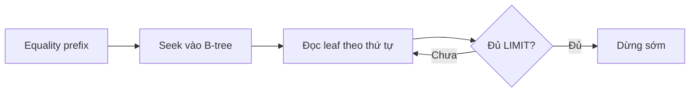

# Thiết kế index B-tree cho query thực tế: từ `ORDER BY` đến `EXPLAIN ANALYZE`

> [!abstract] Luận đề
> Index tốt không phải index “xuất hiện trong `EXPLAIN`”, mà là index làm giảm **công việc vật lý đo được**: số entry phải duyệt, số row phải lấy từ heap/clustered table, số row phải sort, lượng I/O và thời gian CPU. Vì vậy, thứ tự cột phải được suy ra từ hình dạng query và phân bố dữ liệu, không phải từ một quy tắc máy móc như “đặt cột có selectivity cao nhất trước”.

![[assets/composite-btree-query-path.png]]

*Minh họa: equality prefix đưa con trỏ tới một vùng hẹp của B-tree; range/order key quyết định đoạn leaf phải đi; covering có thể tránh bước quay về bảng. Hình do AI tạo để minh họa khái niệm, không phải execution plan cụ thể.*

## 1. Bài toán mẫu và mô hình tư duy đúng

Xét query thường gặp:

```sql
SELECT id, total_cents, created_at
FROM orders
WHERE tenant_id = 42
  AND status = 'paid'
ORDER BY created_at DESC
LIMIT 20;
```

Index khởi đầu hợp lý:

```sql
CREATE INDEX idx_orders_lookup
ON orders (tenant_id, status, created_at DESC);
```

Hai điều kiện equality tạo một prefix xác định. Trong vùng `tenant_id=42, status='paid'`, các entry đã được sắp theo `created_at DESC`; engine có thể đọc 20 row đầu rồi dừng. MySQL mô tả khả năng dùng index cho `ORDER BY`, còn PostgreSQL nhấn mạnh lợi ích đặc biệt của index matching order khi có `LIMIT` ([MySQL — ORDER BY Optimization](https://dev.mysql.com/doc/refman/8.4/en/order-by-optimization.html), [PostgreSQL — Indexes and ORDER BY](https://www.postgresql.org/docs/current/indexes-ordering.html)).



> [!important] Công thức tư duy
> `equality prefix → range hoặc ordering key → tie-breaker → payload cần cover`.
> Đây là điểm xuất phát để benchmark, không phải định luật bất biến.

## 2. Sáu cơ chế cần phân biệt

### 2.1 `ORDER BY`: index có thể thay sort, nhưng chưa chắc nhanh hơn

Index `(tenant_id, status, created_at DESC)` phù hợp vì hai cột đầu bị khóa bằng equality. Một index đảo thứ tự:

```sql
CREATE INDEX idx_bad
ON orders (created_at DESC, tenant_id, status);
```

có thể tránh sort nhưng vẫn phải đi qua rất nhiều entry toàn hệ thống để tìm đủ 20 row của tenant 42. “Không có `filesort`” chỉ chứng minh không sort riêng; nó không chứng minh tổng work thấp.

Mixed-direction ordering cũng cần định nghĩa đúng. PostgreSQL có thể scan B-tree tiến hoặc lùi, nhưng một query kiểu `ORDER BY a ASC, b DESC` cần index có hướng tương ứng nếu muốn lấy trực tiếp đúng thứ tự ([PostgreSQL — Indexes and ORDER BY](https://www.postgresql.org/docs/current/indexes-ordering.html)).

### 2.2 Range là “điểm gãy” của interval liên tục

```sql
CREATE INDEX idx_range
ON orders (tenant_id, created_at, total_cents);

SELECT id, total_cents
FROM orders
WHERE tenant_id = 42
  AND created_at >= '2026-10-01'
  AND created_at <  '2026-11-01'
  AND total_cents >= 10000;
```

| Key part | Vai trò vật lý điển hình |
|---|---|
| `tenant_id = 42` | Giới hạn prefix bằng equality |
| `created_at >= ... < ...` | Xác định range đầu tiên |
| `total_cents >= 10000` | Có thể lọc trong index, nhưng thường không làm range chính thành một interval nhỏ hơn |

MySQL mô tả range access bằng các interval trên index; PostgreSQL mô tả multicolumn B-tree hiệu quả nhất khi các cột đầu có equality và cột không-equality đầu tiên giới hạn phần index cần scan ([MySQL — Range Optimization](https://dev.mysql.com/doc/refman/8.4/en/range-optimization.html), [PostgreSQL — Multicolumn Indexes](https://www.postgresql.org/docs/current/indexes-multicolumn.html)).

### 2.3 Covering index: tránh row lookup, đổi lại write amplification

MySQL/InnoDB:

```sql
CREATE INDEX idx_cover
ON orders (tenant_id, status, created_at DESC, total_cents);
```

Secondary index của InnoDB chứa primary key, nên nếu `id` là PK thì thường không cần lặp lại `id` chỉ để cover. Dấu hiệu trong `EXPLAIN` là `Extra: Using index` ([MySQL — EXPLAIN Output](https://dev.mysql.com/doc/refman/8.4/en/explain-output.html)).

PostgreSQL:

```sql
CREATE INDEX idx_cover
ON orders (tenant_id, status, created_at DESC)
INCLUDE (total_cents);
```

`INCLUDE` tách payload khỏi search key. Tuy nhiên `Index Only Scan` vẫn có thể đọc heap để kiểm tra MVCC nếu visibility map chưa đánh dấu page là all-visible. Bằng chứng mạnh là `Heap Fetches: 0`, không chỉ tên node ([PostgreSQL — Index-Only Scans](https://www.postgresql.org/docs/current/indexes-index-only-scans.html)).

> [!warning] Mistake: cover mọi thứ
> Cột payload rộng làm index phình, giảm cache density, tăng chi phí `INSERT/UPDATE/DELETE` và có thể vượt giới hạn tuple index. Chỉ cover khi số row lookup tránh được đáng kể và workload đọc xứng đáng với chi phí ghi.

### 2.4 ICP: giảm table fetch, không giảm mọi index scan

MySQL Index Condition Pushdown (ICP) đánh predicate trên index tuple trước khi lấy full row. Ví dụ `total_cents` đứng sau range `created_at` vẫn có thể được kiểm tra tại storage engine. Dấu hiệu là `Using index condition` ([MySQL — Index Condition Pushdown](https://dev.mysql.com/doc/refman/8.4/en/index-condition-pushdown-optimization.html)).

ICP tối ưu:

```text
index entries đã đọc → lọc trong index → chỉ row đạt mới lookup bảng
```

ICP **không** biến một scan hàng triệu entry thành selective seek. Vì vậy nó không thay thế một composite index đúng.

PostgreSQL không dùng tên ICP. Hãy phân biệt:

| Plan field | Ý nghĩa |
|---|---|
| `Index Cond` | Điều kiện tham gia index access |
| `Recheck Cond` | Điều kiện phải kiểm tra lại, thường ở bitmap/lossy path |
| `Filter` | Predicate áp dụng sau khi tuple được lấy |

### 2.5 Skip scan: hữu ích khi thiếu leading predicate và NDV thấp

Với index `(status, created_at)` và query chỉ lọc `created_at`, engine có thể lặp qua từng `status` khác nhau rồi range-scan `created_at`. Đây là skip scan.

```text
status=open      → created_at range
status=paid      → created_at range
status=cancelled → created_at range
```

MySQL báo `Using index for skip scan`; PostgreSQL 18 mô tả cơ chế sinh equality động cho prefix bị thiếu. Lợi ích lớn khi số distinct của prefix nhỏ; nếu NDV lớn, số lần re-seek có thể khiến full scan rẻ hơn ([MySQL — Skip Scan Range Access](https://dev.mysql.com/doc/refman/8.4/en/range-optimization.html), [PostgreSQL 18 — Multicolumn Indexes](https://www.postgresql.org/docs/18/indexes-multicolumn.html)).

### 2.6 `FORCE INDEX`: ép candidate set, không ép kết quả tốt

```sql
SELECT ...
FROM orders FORCE INDEX (idx_orders_lookup)
WHERE ...;
```

MySQL nói rõ `FORCE INDEX` hoạt động gần giống `USE INDEX`, đồng thời làm table scan có cost rất cao; nó không cam kết access algorithm, covering, cardinality estimate hay performance. MySQL 8.4 định hướng các optimizer hint `INDEX`, `JOIN_INDEX`, `ORDER_INDEX`, `GROUP_INDEX` thay legacy index hints ([MySQL — Index Hints](https://dev.mysql.com/doc/refman/8.4/en/index-hints.html)).

PostgreSQL core không có tương đương trực tiếp. `SET LOCAL enable_seqscan = off` chỉ **discourage** sequential scan và phù hợp để chẩn đoán, không phải cấu hình production mặc định ([PostgreSQL — Planner Method Configuration](https://www.postgresql.org/docs/current/runtime-config-query.html#RUNTIME-CONFIG-QUERY-ENABLE)).

## 3. Cách đọc `EXPLAIN`: xác nhận work, không ngắm hình plan

### MySQL

| Trường | Cách hiểu đúng |
|---|---|
| `possible_keys` | Candidate; không chứng minh đã dùng |
| `key` | Index được chọn |
| `type=ALL` | Full table scan |
| `type=index` | Full index scan; vẫn có thể đọc gần như toàn bộ index |
| `type=range` | Đọc một hoặc nhiều interval |
| `Using index` | Projection được cover |
| `Using index condition` | ICP |
| `Using filesort` | Có bước sort riêng |
| `Using index for skip scan` | Skip scan |

```sql
EXPLAIN ANALYZE
SELECT ...;
```

Tập trung vào actual time, actual rows và loops. MySQL ghi rõ `EXPLAIN ANALYZE` chạy statement thật, nên tránh dùng vô tư với câu lệnh gây side effect ([MySQL — Obtaining Execution Plan Information](https://dev.mysql.com/doc/refman/8.4/en/explain.html)).

### PostgreSQL

```sql
EXPLAIN (ANALYZE, BUFFERS, TIMING OFF, SUMMARY ON)
SELECT ...;
```

| Tín hiệu | Câu hỏi cần trả lời |
|---|---|
| estimated rows vs actual rows | Statistics có sai lớn không? |
| `Buffers: hit/read` | Query đụng bao nhiêu page? |
| `Heap Fetches` | Index-only có thật sự tránh heap không? |
| `Rows Removed by Filter` | Có lấy quá nhiều rồi mới lọc không? |
| `loops` | Node bị lặp bao nhiêu lần? |
| `Sort Method`/disk | Sort có spill không? |

`cost` là đơn vị nội bộ của planner, không phải milliseconds. `TIMING OFF` giảm overhead đo clock khi chỉ cần actual rows/buffers ([PostgreSQL — Using EXPLAIN](https://www.postgresql.org/docs/current/using-explain.html), [PostgreSQL — EXPLAIN](https://www.postgresql.org/docs/current/sql-explain.html)).

## 4. Dữ liệu benchmark: thứ tự cột quan trọng hơn “có index”

Các số dưới đây là kết quả công bố của từng tác giả, không phải dự báo cho máy của bạn. Chỉ so sánh các dòng trong cùng bộ test.

### MySQL 8.4, 2 triệu orders

Nguồn và phương pháp: [ZeroExp — MySQL Indexes and EXPLAIN Worked Through](https://zeroexp.dev/library/mysql-indexes-explain).

| Strategy | Latency công bố | Work nổi bật |
|---|---:|---|
| Không secondary index | **281 ms** | Scan 2.000.000 row |
| Chỉ `(status)` | **989–1.034 ms** | Rất nhiều entry + table lookup; tệ hơn full scan |
| `(created_at,status,customer_id)` | **1.630–1.663 ms** | Giữ order nhưng scan gần toàn index |
| `(customer_id,status,created_at)` | **0,25–0,28 ms** | Seek đúng prefix, dừng ở 20 row |
| Covering, heavy customer | **0,51 ms** | Tránh lookup payload |

### PostgreSQL 18, 1 triệu orders

Nguồn và phương pháp: [Composite Index Column Order in Postgres — 1M rows](https://www.rakibulinux.com/blogs/postgresql-composite-index-order-prisma).

| Strategy | Latency công bố | Shared buffers |
|---|---:|---:|
| Không index | **53,77 ms** | **8.408** |
| Ba index đơn | **6,05 ms** | **299** |
| Composite sai thứ tự | **3,96 ms** | **429** |
| Composite tốt | **0,20–0,24 ms** | **23** |

Điểm khoa học quan trọng không phải tỷ lệ tuyệt đối mà là cơ chế: index đúng làm giảm pages/entries/row lookups; index sai có thể thêm random I/O mà không giảm candidate set.

## 5. Usage: quy trình thiết kế và kiểm chứng

1. Viết query thật, gồm projection, filter, order, limit và join.
2. Xác định equality prefix; sau đó chọn range hoặc ordering key.
3. Thêm tie-breaker ổn định nếu order key không unique.
4. Chỉ thêm payload để cover sau khi đo row/heap fetch.
5. Tạo dữ liệu có skew giống production, không chỉ dữ liệu đều.
6. Chạy `ANALYZE TABLE` hoặc `ANALYZE` sau khi nạp dữ liệu.
7. So sánh `EXPLAIN ANALYZE` trước/sau: rows, buffers, sort, heap fetches, elapsed time.
8. Đo warm-cache và cold-ish-cache riêng; lặp 30–100 lần, báo median và p95.
9. Đo cả write cost và kích thước index trước khi giữ index mới.

Ví dụ A/B MySQL cho ICP:

```sql
SET optimizer_switch='index_condition_pushdown=off';
EXPLAIN ANALYZE SELECT ...;

SET optimizer_switch='index_condition_pushdown=on';
EXPLAIN ANALYZE SELECT ...;
```

Ví dụ diagnostic PostgreSQL:

```sql
BEGIN;
SET LOCAL enable_seqscan = off;
EXPLAIN (ANALYZE, BUFFERS) SELECT ...;
ROLLBACK;
```

## 6. Mistakes: các lỗi suy luận nguy hiểm

| Sai lầm | Vì sao sai | Cách sửa |
|---|---|---|
| “Có index là nhanh” | Có thể full-index scan + random row lookup | Đọc actual rows/buffers/time |
| “Cột selectivity cao nhất luôn đứng đầu” | Không xét equality, range và order | Thiết kế theo query shape |
| “Sau range, cột sau vô dụng” | Vẫn có thể lọc trong index/ICP | Phân biệt range narrowing với row-fetch filtering |
| “Không `filesort` nghĩa là tối ưu” | Index scan có thể đi rất xa để giữ order | Đo số entry/row và latency |
| “Index Only Scan là zero heap” | PostgreSQL còn phụ thuộc visibility map | Kiểm tra `Heap Fetches` |
| “Skip scan cứu mọi index sai prefix” | Re-seek tăng theo NDV leading column | Benchmark và theo dõi `Index Searches` |
| “`FORCE INDEX` sửa optimizer” | Nó chỉ giới hạn lựa chọn, có thể ép plan tệ | Sửa statistics/index; chỉ hint sau A/B |
| “Benchmark tenant trung bình là đủ” | Skew làm heavy tenant khác hoàn toàn | Test p50, p95 và heavy hitters |

## 7. Checklist production

- [ ] Index khớp equality prefix và order/range thực tế.
- [ ] `ORDER BY ... LIMIT` dừng sớm thay vì quét xa.
- [ ] Estimated rows không lệch actual rows theo cấp số lớn.
- [ ] Không có row lookup hoặc sort bất ngờ.
- [ ] Covering index đem lại lợi ích lớn hơn write/storage cost.
- [ ] Benchmark có data skew, warm/cold cache và concurrency.
- [ ] Hint chỉ tồn tại cùng test chứng minh và kế hoạch loại bỏ.

> [!summary] Kết luận
> Hãy tối ưu lượng work, không tối ưu tên node. Một plan có chữ “index” vẫn có thể chậm; một sequential scan đôi lúc là lựa chọn đúng. Quyết định cuối cùng phải dựa trên `EXPLAIN ANALYZE`, buffers/pages, actual rows và benchmark có phân bố dữ liệu gần production.

## Nguồn chính

- [MySQL 8.4 — Range Optimization](https://dev.mysql.com/doc/refman/8.4/en/range-optimization.html)
- [MySQL 8.4 — Index Condition Pushdown](https://dev.mysql.com/doc/refman/8.4/en/index-condition-pushdown-optimization.html)
- [MySQL 8.4 — Index Hints](https://dev.mysql.com/doc/refman/8.4/en/index-hints.html)
- [MySQL 8.4 — EXPLAIN Output](https://dev.mysql.com/doc/refman/8.4/en/explain-output.html)
- [PostgreSQL 18 — Multicolumn Indexes](https://www.postgresql.org/docs/18/indexes-multicolumn.html)
- [PostgreSQL — Index-Only Scans](https://www.postgresql.org/docs/current/indexes-index-only-scans.html)
- [PostgreSQL — Using EXPLAIN](https://www.postgresql.org/docs/current/using-explain.html)
- [ZeroExp — MySQL composite-index benchmark](https://zeroexp.dev/library/mysql-indexes-explain)
- [RakibuLinux — PostgreSQL composite-index benchmark](https://www.rakibulinux.com/blogs/postgresql-composite-index-order-prisma)

