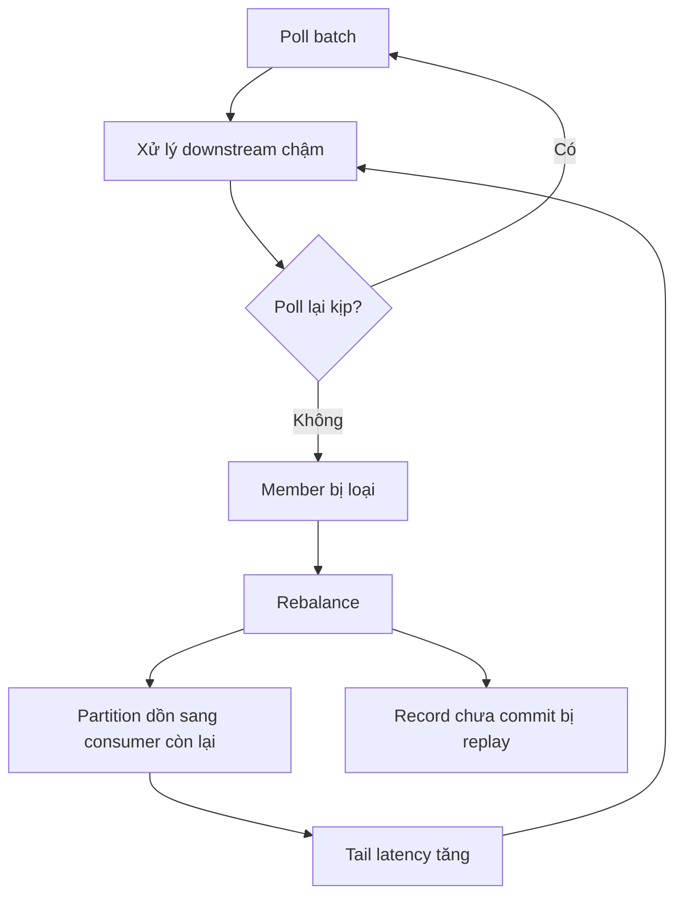
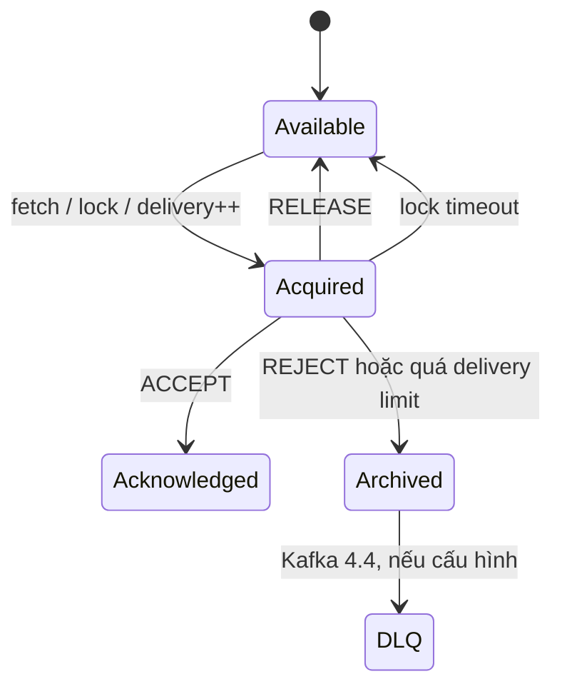

# Kafka làm work queue: Consumer Group, rebalance storm và Share Groups 4.x

> [!abstract] Luận đề
> Nói “Kafka không phải queue” đã lỗi thời nếu hiểu tuyệt đối: Kafka 4.2 đưa KIP-932 Share Groups lên production-ready, với concurrent consumption trong cùng partition, per-record acknowledgement, delivery count và acquisition lock; Kafka 4.4 thêm DLQ. Nhưng **classic consumer group** vẫn tối ưu cho ordered partitioned stream, không phải pool job độc lập. Chọn đúng mô hình ownership quan trọng hơn chọn theo tên sản phẩm.

> [!info] Mốc thời gian
> Nội dung được kiểm tra tại **02-11-2026**. Trạng thái hỗ trợ Kafka/managed service/client thay đổi nhanh; hãy mở các link nguồn trước quyết định production.

![[assets/kafka-consumer-vs-share-groups.png]]

*Bên trái: một partition thuộc độc quyền một consumer trong classic group. Bên phải: record-level acquisition cho phép nhiều worker chia sẻ work từ cùng partition. Hình do AI tạo để minh họa, không thay thế protocol specification.*

## 1. “Queue” có ba nghĩa khác nhau

Kafka truyền thống là replicated append-only log. Record không biến mất sau khi đọc; consumer group lưu tiến độ bằng offset. Trong một classic consumer group, mỗi partition chỉ được gán cho một member tại một thời điểm. Đây là “queue-like distribution”, nhưng đơn vị điều phối vẫn là **partition**.

Work queue truyền thống điều phối **message**. RabbitMQ giữ delivery ở trạng thái unacked và redeliver nếu worker chết; SQS ẩn message trong visibility timeout rồi làm nó visible lại nếu chưa delete ([RabbitMQ Work Queues](https://www.rabbitmq.com/tutorials/tutorial-two-java), [AWS SQS Visibility Timeout](https://docs.aws.amazon.com/AWSSimpleQueueService/latest/SQSDeveloperGuide/sqs-visibility-timeout.html)).

Share Groups của KIP-932 thêm đơn vị điều phối **record acquisition** vào Kafka. Nhiều consumer có thể xử lý record từ cùng partition, mỗi record có acquisition lock, delivery count và acknowledgement riêng ([KIP-932 — Queues for Kafka](https://cwiki.apache.org/confluence/spaces/KAFKA/pages/255070434/KIP-932%2BQueues%2Bfor%2BKafka)).

| Thuộc tính | Classic Consumer Group | Kafka Share Group | Queue-native điển hình |
|---|---|---|---|
| Ownership | Partition → consumer | Record lock trong share-partition | Message → worker |
| Parallelism | Bị chặn bởi số partition active | Consumer có thể nhiều hơn partition | Theo in-flight/prefetch/worker |
| Progress | Offset của partition | Per-record accept/release/reject | Ack/delete |
| Ordering | Mạnh trong partition | Có thể out-of-order khi redelivery | Thường không global; FIFO là chế độ riêng |
| Failure recovery | Membership timeout + rebalance + replay | Lock timeout + redelivery | Ack/visibility timeout + redelivery |
| Retry/DLQ | App thường tự xây retry topic/DLQ | Delivery count; DLQ từ 4.4 | First-class pattern |
| Scale worker | Thêm partition hoặc chấp nhận idle member | Scale độc lập hơn với partition | Scale worker pool |

> [!tip] Câu hỏi kiến trúc tốt nhất
> Bạn muốn ownership ở cấp **partitioned ordered stream** hay ở cấp **independent work item**?

## 2. Vì sao classic consumer group dễ thành rebalance storm

Consumer phải duy trì hai loại liveness:

- heartbeat trước `session.timeout.ms`;
- gọi `poll()` trước `max.poll.interval.ms`.

Nếu poll loop nhận một batch rồi gọi API/DB chậm, member có thể bị loại dù process vẫn chạy. Một budget thô:

$$
P99(\text{batch processing}) < \texttt{max.poll.interval.ms} - \text{safety margin}
$$

Với xử lý tuần tự, có thể xấp xỉ:

$$
N_{records} \times P99(T_{record}) \ll \texttt{max.poll.interval.ms}
$$

Đây là mô hình thiết kế, không phải công thức giao thức. Nó phơi bày failure cliff: khi tail latency vượt poll interval, member rời group → partition dồn sang member còn lại → tải tăng → member khác lại timeout.



KIP-429 cooperative rebalance giảm stop-the-world bằng incremental revoke/assign; KIP-848 đưa assignment về server và loại global synchronization barrier trong consumer protocol mới ([KIP-429](https://cwiki.apache.org/confluence/spaces/KAFKA/pages/103090108/KIP-429%2BKafka%2BConsumer%2BIncremental%2BRebalance%2BProtocol), [KIP-848](https://cwiki.apache.org/confluence/spaces/KAFKA/pages/217387038/KIP-848%2BThe%2BNext%2BGeneration%2Bof%2Bthe%2BConsumer%2BRebalance%2BProtocol)). Chúng giảm disruption, nhưng không biến offset thành per-job ack.

## 3. Production evidence: VGS tăng throughput hơn 10 lần

Very Good Security công bố một case Kafka 2.8.1 với topic 100 partition và 100 consumer. Group liên tục rebalance, backlog tăng, throughput chỉ khoảng 13 request/s. Họ từng scale lên 400 consumer, nhưng 300 member bổ sung không tạo thêm partition-level parallelism và làm coordination nặng hơn. Sau khi tune batch/timeout và chuyển Cooperative Sticky Assignor, throughput đạt khoảng 135 request/s ([VGS — Solving Kafka Rebalancing Issues](https://www.verygoodsecurity.com/blog/posts/solving-kafka-rebalancing-issues-a-case-study)).

| Chỉ số công bố | Trước | Thử scale sai | Sau tuning/protocol |
|---|---:|---:|---:|
| Partitions | 100 | 100 | 100 |
| Consumers | 100 | 400 | 100 |
| Throughput | ~13 req/s | Không cải thiện bền vững | ~135 req/s |
| Trạng thái group | Rebalance kéo dài | Coordination tệ hơn | Ổn định hơn |

Con số không chứng minh Cooperative Sticky luôn tạo ra 10×; nó chứng minh một feedback loop coordination có thể ăn gần hết năng lực xử lý dù CPU/broker chưa phải bottleneck gốc.

Cloudflare mô tả một amplifier khác: liveness probe giữ stale partition-offset state sau rebalance, kết luận nhầm consumer “không tiến”, restart pod, rồi chính restart tạo rebalance tiếp theo. Họ phải rebuild health-check state theo assignment hiện tại ([Cloudflare — Intelligent automatic restarts](https://blog.cloudflare.com/intelligent-automatic-restarts-for-unhealthy-kafka-consumers/)).

## 4. Ba “miếng vá” và phạm vi thật sự

### 4.1 Tăng consumer

**Usage đúng:** số consumer hiện thấp hơn partition count và các partition phân bố tương đối đều.

**Không sửa:** job dài, hot partition, per-record retry, hoặc group churn. Với 24 partition, 96 classic consumers không tạo 96-way Kafka-level parallelism; tối đa khoảng 24 member có assignment.

### 4.2 Tăng timeout, giảm `max.poll.records`

```properties
max.poll.records=50
max.poll.interval.ms=900000
session.timeout.ms=60000
```

**Usage đúng:** batch processing có upper bound đo được; cần giảm false eviction.

**Trade-off:** timeout dài làm failure detection chậm; batch nhỏ giảm throughput nếu per-poll/per-commit overhead lớn. Timeout 60 phút không tạo per-message visibility timeout; nó chỉ cho một consumer giữ partition lâu hơn.

### 4.3 Cooperative rebalance và static membership

```properties
partition.assignment.strategy=org.apache.kafka.clients.consumer.CooperativeStickyAssignor
group.instance.id=worker-${HOSTNAME}
```

Cooperative Sticky giảm partition revoke không cần thiết. Static membership giảm rebalance do restart ngắn ([KIP-345](https://cwiki.apache.org/confluence/spaces/KAFKA/pages/87300241/KIP-345%2BIntroduce%2Bstatic%2Bmembership%2Bprotocol%2Bto%2Breduce%2Bconsumer%2Brebalances)).

**Không sửa:** per-record acknowledgement, nhiều worker cùng một partition, lock/retry lifecycle. Đây là lý do KIP-932 tạo group type mới.

## 5. Share Groups 4.x: state machine của work item

Kafka 4.2 đánh dấu KIP-932 production-ready; Kafka 4.4 thêm DLQ qua KIP-1191 ([Kafka 4.2 upgrade notes](https://kafka.apache.org/44/getting-started/upgrade/), [Kafka 4.4 release](https://kafka.apache.org/blog/2026/10/22/apache-kafka-4.4.0-release-announcement/)).



KIP-932 mô tả bốn state: Available, Acquired, Acknowledged, Archived. Mặc định lock có thời hạn; record lỗi lặp lại tăng delivery count. Delivery semantics là at-least-once, và redelivery có thể phá ordering. Đây là sự đánh đổi có chủ ý để scale work item độc lập.

Kiểm tra feature và group:

```bash
bin/kafka-features.sh \
  --bootstrap-server kafka-1:9092 \
  describe

bin/kafka-share-groups.sh \
  --bootstrap-server kafka-1:9092 \
  --describe \
  --group image-workers
```

Kafka 4.4 DLQ cần `share.version=2`. Ví dụ cấu hình chính thức:

```bash
bin/kafka-configs.sh \
  --bootstrap-server kafka-1:9092 \
  --alter \
  --entity-type groups \
  --entity-name image-workers \
  --add-config \
  "errors.deadletterqueue.topic.name=dlq.image-workers"
```

Xem [Kafka 4.4 — Basic Kafka Operations](https://kafka.apache.org/44/operations/basic-kafka-operations/) và [KIP-1191 — DLQ for Share Groups](https://cwiki.apache.org/confluence/spaces/KAFKA/pages/373885564/KIP-1191%2BDead-letter%2Bqueues%2Bfor%2Bshare%2Bgroups).

## 6. Vì sao chưa nên mặc định chọn Share Groups

Production-ready ở upstream không đồng nghĩa ecosystem của bạn đã sẵn sàng.

| Rào cản tại 02-11-2026 | Bằng chứng |
|---|---|
| Tính năng còn mới | Production-ready từ Kafka 4.2; DLQ mới ở 4.4 |
| Managed service không đồng đều | AWS MSK 4.2 Express ghi rõ chưa hỗ trợ KIP-932 |
| Client khác Java có thể thiếu tính năng | Cần xác minh client/binding và renew/admin/DLQ support |
| Ordering bị nới lỏng | KIP-932 cho phép out-of-order, nhất là khi redelivery |
| Operational surface mới | Share coordinator, record locks, delivery state, feature level, DLQ |

AWS hiện ghi rõ Kafka 4.2 chỉ có trên Express broker và KIP-932 chưa được hỗ trợ ở đó ([AWS MSK — Supported Kafka Versions](https://docs.aws.amazon.com/msk/latest/developerguide/supported-kafka-versions.html)). Vì vậy, đừng suy từ version string rằng feature chắc chắn khả dụng.

## 7. Usage: chọn mô hình theo workload

| Workload | Lựa chọn mặc định hợp lý |
|---|---|
| Event cần replay, nhiều subscriber, ordering theo key | Classic consumer group |
| Kafka Streams/stateful computation theo partition | Classic/new consumer protocol |
| Job độc lập, duration lệch mạnh, retry/DLQ là first-class | Queue-native hoặc Share Group |
| Đã vận hành Kafka backbone, chấp nhận at-least-once và không cần strict order | Pilot Share Group |
| Chỉ cần gửi email/render PDF/call webhook, chưa có Kafka | Queue-native thường đơn giản hơn |

### Checklist pilot Share Group

- [ ] Broker và feature level hỗ trợ chính xác.
- [ ] Managed service không chặn KIP-932.
- [ ] Client ngôn ngữ có accept/release/reject/renew cần thiết.
- [ ] Handler idempotent theo message/business key.
- [ ] Lock duration lớn hơn tail xử lý hoặc có renew an toàn.
- [ ] Delivery limit và DLQ có runbook replay.
- [ ] Workload chấp nhận out-of-order.
- [ ] So sánh TCO với RabbitMQ/SQS/Pub/Sub, không chỉ throughput.

## 8. Mistakes và cách sửa

| Mistake | Failure mode | Cách sửa |
|---|---|---|
| Scale consumer theo lag mà quên partition count | Idle member + coordinator load + rebalance | Bound replicas theo partition và đo assignment |
| Gọi HTTP/DB lâu ngay trên poll loop | Vượt poll interval, rebalance storm | Budget batch, async/bounded executor hoặc đổi queue model |
| Tăng timeout vô hạn | Failover chậm; partition bị giữ lâu | Đặt upper bound và đo P99/P999 |
| Liveness probe dựa stale offset | Cascading restart/rebalance | Reset state theo assignment; phân biệt idle và stuck |
| `enable.auto.commit=true` như per-job ack | Side effect xong nhưng offset chưa commit → duplicate | Idempotency key/transactional boundary |
| Tin “exactly once” cho external side effect | Kafka transaction không tự bao phủ email/HTTP/payment | Thiết kế idempotent consumer/outbox |
| Dùng Share Group nhưng vẫn yêu cầu strict ordering | Redelivery có thể đảo order | Giữ classic group hoặc thiết kế sequencing riêng |
| Bật DLQ rồi bỏ quên | Poison message bị lưu nhưng không được xử lý | SLO, alert, ownership và replay tool |

## 9. Runbook quan sát rebalance storm

1. Kiểm tra group state, member count, assignment và rebalance rate.
2. So sánh processing P99 với `max.poll.interval.ms`.
3. Kiểm tra GC pause, network, rolling restart và liveness probe.
4. Đối chiếu consumer count với partition count và hot-partition skew.
5. Xem coordinator request latency/network; group lớn có thể tạo broker-side pressure.
6. Giảm batch hoặc tách long-running work; triển khai Cooperative Sticky/KIP-848 nếu phù hợp.
7. Nếu phải dựng quá nhiều lớp pause/resume/retry/DLQ, đánh giá lại abstraction.

> [!summary] Kết luận
> Kafka giờ có queue thật, nhưng có hai abstraction khác nhau trong cùng hệ sinh thái. Classic consumer group rất mạnh cho ordered stream theo partition. Share Groups/queue-native broker phù hợp hơn khi mỗi record là một job có lifecycle riêng. Đừng hỏi “Kafka có làm được không”; hãy hỏi “failure, retry, ordering và ownership của workload này nằm ở cấp nào?”.

## Nguồn chính

- [KIP-932 — Queues for Kafka](https://cwiki.apache.org/confluence/spaces/KAFKA/pages/255070434/KIP-932%2BQueues%2Bfor%2BKafka)
- [Kafka 4.4 Release — Share Group DLQ](https://kafka.apache.org/blog/2026/10/22/apache-kafka-4.4.0-release-announcement/)
- [KIP-1191 — Dead-letter queues for Share Groups](https://cwiki.apache.org/confluence/spaces/KAFKA/pages/373885564/KIP-1191%2BDead-letter%2Bqueues%2Bfor%2Bshare%2Bgroups)
- [KIP-429 — Cooperative Rebalance](https://cwiki.apache.org/confluence/spaces/KAFKA/pages/103090108/KIP-429%2BKafka%2BConsumer%2BIncremental%2BRebalance%2BProtocol)
- [KIP-848 — Next-generation Consumer Rebalance](https://cwiki.apache.org/confluence/spaces/KAFKA/pages/217387038/KIP-848%2BThe%2BNext%2BGeneration%2Bof%2Bthe%2BConsumer%2BRebalance%2BProtocol)
- [VGS — Solving Kafka Rebalancing Issues](https://www.verygoodsecurity.com/blog/posts/solving-kafka-rebalancing-issues-a-case-study)
- [Cloudflare — Kafka consumer health-check failure loop](https://blog.cloudflare.com/intelligent-automatic-restarts-for-unhealthy-kafka-consumers/)
- [AWS MSK — Supported Kafka Versions](https://docs.aws.amazon.com/msk/latest/developerguide/supported-kafka-versions.html)
- [RabbitMQ — Work Queues](https://www.rabbitmq.com/tutorials/tutorial-two-java)
- [AWS SQS — Visibility Timeout](https://docs.aws.amazon.com/AWSSimpleQueueService/latest/SQSDeveloperGuide/sqs-visibility-timeout.html)

