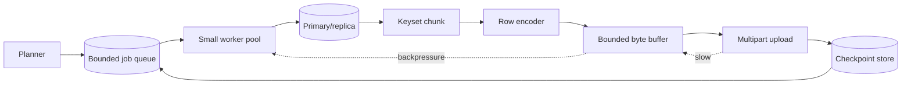
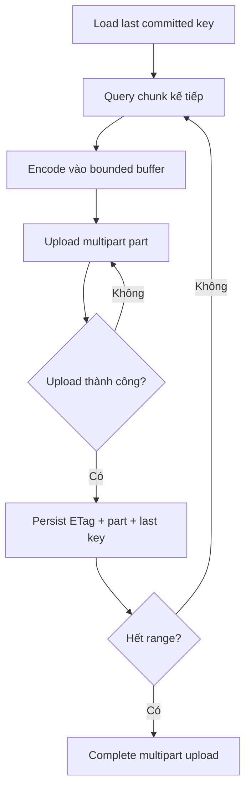

# Export 5 triệu dòng mà không làm quá tải database

> [!abstract] Luận đề
> Năm triệu row không tự thân là nguy hiểm. Rủi ro đến từ cách tìm row, thời gian giữ snapshot/connection, tốc độ client tiêu thụ, concurrency, backpressure và việc lỗi upload có buộc chạy lại từ đầu hay không. Thiết kế an toàn thường là **keyset/range chunks + streaming có buffer hữu hạn + resumable multipart upload + checkpoint chỉ tiến sau khi bytes đã bền vững**.

![[assets/resilient-database-export-pipeline.png]]

*Pipeline: database → range chunks → bounded buffer → multipart object storage; checkpoint tạo biên durability, còn backpressure truyền ngược để ngăn đọc vượt tốc độ ghi. Hình do AI tạo để minh họa kiến trúc.*

## 1. Bốn trục rủi ro độc lập

| Trục | Câu hỏi phải trả lời |
|---|---|
| Access path | Database seek tới cursor hay scan rồi bỏ hàng triệu row? |
| Consistency | Cần một snapshot thống nhất hay chấp nhận mỗi chunk ở thời điểm khác nhau? |
| Flow control | Upload chậm có làm RAM tăng vô hạn hoặc DB socket đứng đọc? |
| Recovery | Crash ở 80% có resume từ checkpoint hay chạy lại từ 0? |

Một kiến trúc tốt không chỉ “query nhanh”. Nó giới hạn blast radius: chunk nhỏ, connection có tuổi thọ hữu hạn, worker count bounded, retry deterministic và checkpoint gắn với durability thật.

## 2. `OFFSET` không phải vị trí trong B-tree

```sql
SELECT id, created_at, customer_id, amount
FROM orders
ORDER BY created_at, id
LIMIT 1000 OFFSET 4000000;
```

Database phải tạo ít nhất 4.001.000 row theo đúng thứ tự, bỏ 4.000.000 row rồi mới trả 1.000. Index có thể bỏ sort nhưng không bỏ việc skip. PostgreSQL ghi rõ rows bị `OFFSET` bỏ qua vẫn phải được tính và large offset có thể kém hiệu quả ([PostgreSQL — LIMIT and OFFSET](https://www.postgresql.org/docs/current/queries-limit.html)).

Benchmark MySQL 8.4 trên 1 triệu row cho thấy hình dạng tăng tuyến tính theo độ sâu ([ZeroExp — MySQL Keyset Pagination](https://zeroexp.dev/library/mysql-keyset-pagination)):

| Vị trí bắt đầu | `OFFSET` | Keyset |
|---:|---:|---:|
| 0 | 0,70 ms | 0,90 ms |
| 10.000 | 1,77 ms | 0,61 ms |
| 100.000 | 10,60 ms | 1,36 ms |
| 500.000 | 50,39 ms | 0,65 ms |
| 900.000 | **321,68 ms** | **1,14 ms** |

Ở offset 900.000, plan tạo khoảng 900.020 row từ index scan để trả 20 row. Đây là lý do chia export thành 5.000 query `LIMIT 1000 OFFSET n` có thể tệ hơn một sequential walk: các prefix đầu bị duyệt lại liên tục.

## 3. Keyset nhanh khi predicate thực sự trở thành range seek

Với khóa duy nhất:

```sql
SELECT id, created_at, customer_id, amount
FROM orders
WHERE id > :cursor
ORDER BY id
LIMIT 10000;
```

Với order key không unique, cần tie-breaker:

```sql
-- PostgreSQL
SELECT id, created_at, customer_id, amount
FROM orders
WHERE (created_at, id) > (:created_at, :id)
ORDER BY created_at, id
LIMIT 10000;
```

```sql
CREATE INDEX ix_orders_export
ON orders (created_at, id);
```

Keyset làm work gần với `B-tree seek + page size`, thay vì `offset + page size`. Nhưng câu SQL có chữ `WHERE id > ?` chưa đủ: index leading keys phải khớp filter/order, kiểu dữ liệu/collation phải tương thích, và `EXPLAIN ANALYZE` phải cho thấy range/index condition thực sự.

Với MySQL, row constructor trên composite key có thể không luôn được tối ưu thành range tốt ở mọi version/query shape. Dạng mở rộng thường an toàn hơn và phải benchmark:

```sql
WHERE created_at > :ts
   OR (created_at = :ts AND id > :id)
ORDER BY created_at, id
LIMIT 10000;
```

> [!warning] Mistake: “Keyset chỉ nhanh khi covering”
> Sai. Covering không cần thiết cho seek. Non-covering keyset vẫn chỉ lookup payload cho khoảng một page kết quả. Covering giúp tránh heap/clustered-row fetch, nhưng đổi lại index lớn và write cost cao.

PostgreSQL covering:

```sql
CREATE INDEX CONCURRENTLY ix_orders_export
ON orders (created_at, id)
INCLUDE (customer_id, amount, status);
```

Index-only scan còn phụ thuộc visibility map; kiểm tra `Heap Fetches` ([PostgreSQL — Index-Only Scans](https://www.postgresql.org/docs/current/indexes-index-only-scans.html)). Không cover cột text/JSON lớn chỉ để phục vụ một export hiếm.

## 4. Kiến trúc có backpressure và durability boundary



### Worker item tối thiểu

```text
export_id
partition_id
lower_key_exclusive
upper_key_inclusive
last_committed_key
upload_id
next_part_number
output_schema_version
snapshot_id?          # chỉ khi cần snapshot chung
status
```

### Quy tắc checkpoint

> [!important] Durability rule
> Tiến độ database chỉ được commit sau khi bytes tương ứng đã upload thành công và metadata part/checksum đã được lưu bền vững.



Nếu process chết sau `UploadPart` nhưng trước checkpoint, upload lại cùng part number có thể thay thế part cũ trên S3; retry vì vậy có thể deterministic ([AWS S3 — Multipart Upload Overview](https://docs.aws.amazon.com/AmazonS3/latest/userguide/mpuoverview.html)). Lưu `(upload_id, part_number, ETag/checksum, first_key, last_key, row_count, byte_count)`.

## 5. Streaming không đồng nghĩa mọi driver đều giống nhau

### Go `database/sql`

`Rows` là iterator ở API level; buffering thực tế phụ thuộc driver. Usage đúng là scan và encode ngay:

```go
rows, err := db.QueryContext(ctx, query, cursor, upper, chunkSize)
if err != nil { return err }
defer rows.Close()

for rows.Next() {
    if err := rows.Scan(&id, &createdAt, &customerID, &amount); err != nil {
        return err
    }
    if err := csvWriter.Write(encodeRow(...)); err != nil {
        return err
    }
}
return rows.Err()
```

Không append 5 triệu object vào slice trước khi upload. Giới hạn `SetMaxOpenConns`; export worker count không nên tự động bằng CPU core count.

### PostgreSQL JDBC

pgJDBC mặc định có thể lấy toàn bộ result. Cursor-based fetching cần autocommit off, forward-only result và positive fetch size ([pgJDBC — Query with a Cursor](https://jdbc.postgresql.org/documentation/query/#getting-results-based-on-a-cursor)):

```java
conn.setAutoCommit(false);
PreparedStatement ps = conn.prepareStatement(
    sql,
    ResultSet.TYPE_FORWARD_ONLY,
    ResultSet.CONCUR_READ_ONLY
);
ps.setFetchSize(10_000);
```

### MySQL Connector/J

Row-at-a-time streaming:

```java
Statement st = conn.createStatement(
    ResultSet.TYPE_FORWARD_ONLY,
    ResultSet.CONCUR_READ_ONLY
);
st.setFetchSize(Integer.MIN_VALUE);
```

Server cursor fetching:

```text
jdbc:mysql://db/export?useCursorFetch=true&defaultFetchSize=10000
```

Connector/J mô tả cả hai mode và cảnh báo phải đọc hết hoặc đóng streamed result trước query khác trên cùng connection ([MySQL Connector/J — JDBC Implementation Notes](https://dev.mysql.com/doc/connector-j/en/connector-j-reference-implementation-notes.html), [Connector/J — Performance Extensions](https://dev.mysql.com/doc/connector-j/en/connector-j-connp-props-performance-extensions.html)).

## 6. Network timeout là một phần của query design

Nếu exporter ngừng đọc socket để chờ upload, MySQL server có thể chạm `net_write_timeout`; default MySQL 8.4 là 60 giây. Connector/J có `netTimeoutForStreamingResults`, default 600 giây ([MySQL 8.4 — Server System Variables](https://dev.mysql.com/doc/refman/8.4/en/server-system-variables.html), [Connector/J — Result Set Properties](https://dev.mysql.com/doc/connector-j/en/connector-j-connp-props-result-sets.html)).

| Failure | Biểu hiện | Thiết kế phòng vệ |
|---|---|---|
| Upload chậm | DB socket không được drain | Chunk nhỏ; upload giữa chunks; bounded pipe |
| DB connection reset | Chunk dở dang | Retry từ durable cursor |
| Worker crash | Multipart upload còn dang dở | Persist upload ID/parts; resume hoặc abort |
| Checkpoint write fail | Remote part có thể đã tồn tại | Re-upload deterministic part number |
| Retry đồng thời | Duplicate part/chunk | Lease/CAS trên checkpoint |
| Query timeout | Partial result | Chunk đủ nhỏ để retry rẻ |

Không chỉ “tăng timeout”. Timeout dài che slow consumer và kéo dài resource retention. Mục tiêu là giữ mỗi query/chunk nằm trong một latency envelope đo được.

## 7. Consistency: snapshot thống nhất hay export có thể resume?

### Một snapshot dài

Ưu điểm: toàn bộ file phản ánh một thời điểm logic. Nhược điểm: connection/transaction sống lâu; PostgreSQL giữ `backend_xmin` cũ có thể cản vacuum; InnoDB phải giữ undo version lâu hơn.

### Các chunk độc lập

Ưu điểm: retry/resume dễ, giải phóng connection giữa chunks, failure nhỏ. Nhược điểm: dữ liệu có thể thay đổi giữa chunk; update/delete/insert cần semantics rõ.

Các chiến lược:

| Yêu cầu | Cách tiếp cận |
|---|---|
| Backup/migration nhất quán | `pg_dump`, `mysqldump --single-transaction --quick`, native dump |
| CSV/filter tùy biến, chấp nhận snapshot theo chunk | Keyset/range chunks |
| Snapshot chung + parallel worker | Exported snapshot/DB-native tooling; vận hành phức tạp hơn |
| Incremental business export | Watermark + immutable key/version + audit semantics |

PostgreSQL `COPY (SELECT ...) TO STDOUT` nên được benchmark trước JDBC row serialization khi output phù hợp ([PostgreSQL — COPY](https://www.postgresql.org/docs/current/sql-copy.html)). `pg_dump` hỗ trợ consistent export và parallel directory format; `-j` tăng connection/load ([PostgreSQL — pg_dump](https://www.postgresql.org/docs/current/app-pgdump.html)).

MySQL 8.4 đã loại `mysqlpump`; dùng `mysqldump` hoặc MySQL Shell dump utilities. MySQL Shell hỗ trợ chunking, parallel threads, compression và rate limiting ([MySQL Shell — Dump Utilities](https://dev.mysql.com/doc/mysql-shell/8.4/en/mysql-shell-utilities-dump-instance-schema.html)).

## 8. Usage: cấu hình ban đầu và cách tune

Một starting point thận trọng, không phải guarantee:

| Tham số | Giá trị khởi đầu | Tune theo |
|---|---:|---|
| Workers | 2–4 | DB latency, read IOPS, replica lag |
| DB chunk | 10k–50k rows | Row width, query p95, retry cost |
| Multipart part | 32–128 MiB | Compression, network, memory |
| Buffer | 1–2 parts/worker | RSS và upload jitter |
| Connections | Workers + control nhỏ | DB connection budget |

Quy trình:

1. Dùng một worker, xác nhận range seek bằng `EXPLAIN ANALYZE`.
2. Đo rows/s, bytes/s, chunk p95/p99, DB buffers/IOPS và upload latency.
3. Tăng worker từng bước; dừng khi latency/replica lag tăng nhanh hơn throughput.
4. Rate-limit theo DB pressure, không theo CPU exporter đơn thuần.
5. Test kill -9, network loss, upload timeout và checkpoint conflict.
6. Đối soát row count, duplicate key, gap và checksum trước khi mark complete.

## 9. Bảng monitoring tối thiểu

| Khu vực | Metrics |
|---|---|
| Export | rows/s, bytes/s, durable cursor, ETA |
| Query | p50/p95/p99, rows/chunk, rows examined, buffers |
| DB | CPU, read IOPS, cache hit, active sessions |
| PostgreSQL | `backend_xmin` age, dead tuples, autovacuum lag |
| MySQL | history list length, buffer-pool reads, aborted clients |
| Pipeline | buffer bytes, saturation time, backpressure duration |
| Object storage | part latency, retries, throughput |
| Correctness | duplicate keys, gaps, checkpoint regressions |
| Runtime | RSS, GC pauses, sockets, TCP retransmits |

## 10. Mistakes chi tiết

| Mistake | Hậu quả khoa học/vận hành | Cách sửa |
|---|---|---|
| Deep `OFFSET` theo page | Work tăng theo tổng offset | Keyset/range scan |
| Không có tie-breaker unique | Bỏ sót/lặp row cùng timestamp | `ORDER BY created_at, id` |
| Tin tuple predicate luôn tối ưu ở MySQL | Có thể full index scan | Mở rộng predicate + `EXPLAIN ANALYZE` |
| Một query 5M row duy nhất | Connection/snapshot/socket sống quá lâu | Bounded chunks |
| Buffer row không giới hạn | OOM khi upload chậm | Bounded byte buffer |
| Upload trong khi bỏ mặc DB socket | `net_write_timeout`/connection reset | Upload giữa chunks hoặc drain qua bounded pipe |
| Checkpoint trước upload | File có gap sau crash | Chỉ advance sau remote durability |
| Checkpoint chỉ theo row count | Không xác định resume key ổn định | Lưu last ordered unique key |
| Chia `MIN(id)..MAX(id)` đều | Range lệch do gap/skew | Sample boundary keys/partition tự nhiên |
| Quá nhiều worker | Cache churn, IOPS/replica lag tăng | Adaptive concurrency cap |
| Snapshot nhiều giờ mà không theo dõi | Vacuum/undo pressure | Native dump, replica hoặc chunk consistency |
| Tạo covering index cực rộng | Write/storage/cache penalty | Chỉ cover projection hẹp và export thường xuyên |

## 11. Decision table

| Cơ chế | Khi nên dùng | Khi tránh |
|---|---|---|
| `LIMIT/OFFSET` | UI page nhỏ, độ sâu giới hạn | Full export/deep pagination |
| Keyset chunks | App export có cursor ổn định | Cần random page number |
| One huge stream | One-off đơn giản, snapshot ngắn | Resume/SLA nghiêm ngặt |
| PostgreSQL `COPY` | CSV/native bulk transfer | Checkpoint per business chunk phức tạp |
| `pg_dump`/MySQL dump | Backup/migration, consistency | Format nghiệp vụ tùy biến |
| Custom exporter | Filtering/encoding/upload/checkpoint đặc thù | Khi native tool đã đáp ứng hoàn toàn |

> [!summary] Kết luận
> Thiết kế export tốt biến một công việc khổng lồ thành chuỗi đơn vị nhỏ, deterministic và có thể phục hồi. Keyset giảm work của database; buffer hữu hạn truyền backpressure; multipart + checkpoint tạo durability boundary; consistency được chọn rõ thay vì vô tình giữ transaction nhiều giờ. Và mọi giả định phải được kiểm chứng bằng plan thật, failure injection và telemetry production.

## Nguồn chính

- [PostgreSQL — LIMIT and OFFSET](https://www.postgresql.org/docs/current/queries-limit.html)
- [PostgreSQL — Index-Only Scans](https://www.postgresql.org/docs/current/indexes-index-only-scans.html)
- [PostgreSQL — COPY](https://www.postgresql.org/docs/current/sql-copy.html)
- [PostgreSQL — pg_dump](https://www.postgresql.org/docs/current/app-pgdump.html)
- [pgJDBC — Cursor-based Results](https://jdbc.postgresql.org/documentation/query/#getting-results-based-on-a-cursor)
- [MySQL Connector/J — Streaming Results](https://dev.mysql.com/doc/connector-j/en/connector-j-reference-implementation-notes.html)
- [MySQL Shell — Dump Utilities](https://dev.mysql.com/doc/mysql-shell/8.4/en/mysql-shell-utilities-dump-instance-schema.html)
- [AWS S3 — Multipart Upload](https://docs.aws.amazon.com/AmazonS3/latest/userguide/mpuoverview.html)
- [ZeroExp — MySQL Keyset Pagination Benchmark](https://zeroexp.dev/library/mysql-keyset-pagination)

