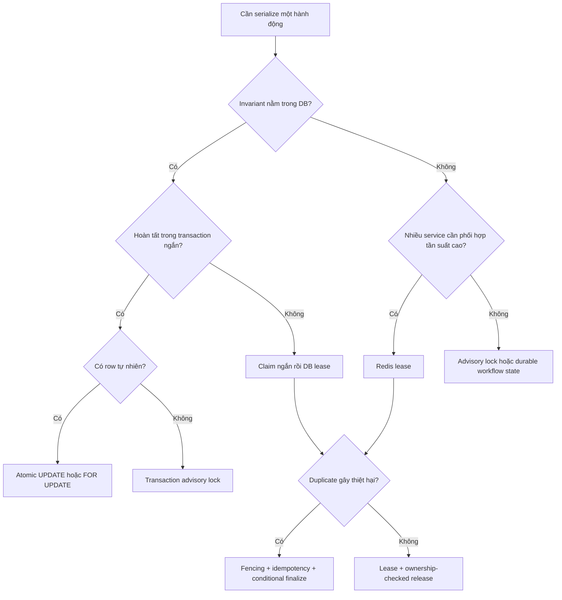

# Chọn cơ chế khóa bi quan đúng bài toán: `FOR UPDATE`, advisory lock, DB lease hay Redis?

> [!abstract] Luận đề
> “Pessimistic locking đã lỗi thời vì giữ connection quá lâu” là một kết luận sai loại. `SELECT ... FOR UPDATE` chỉ là **một** primitive. Câu hỏi đúng không phải “khóa nào nhanh nhất?”, mà là: **ai sở hữu trạng thái phối hợp, sự kiện nào chấm dứt quyền sở hữu, và owner cũ có còn gây hại sau khi quyền đó kết thúc không?**

![[assets/pessimistic-coordination-decision-framework-final.png]]

*Bốn primitive được phân biệt theo lifetime, scope, sự kiện giải phóng và rủi ro stale owner. Hình do AI tạo để minh họa; nội dung kỹ thuật được đối chiếu với tài liệu PostgreSQL và Redis.*

## 1. “Lock” đang nói về hai cơ chế khác nhau

### Khóa do database engine quản lý

Với `SELECT ... FOR UPDATE`, PostgreSQL khóa các row đã chọn cho đến khi transaction kết thúc. Writer hoặc locker xung đột phải đợi; một `SELECT` thường không bị chặn. Khi client mất session, transaction kết thúc và engine dọn khóa ([PostgreSQL — Explicit Locking](https://www.postgresql.org/docs/current/explicit-locking.html)).

```text
BEGIN ── đọc + khóa ── kiểm tra invariant ── UPDATE ── COMMIT
       <------------- khóa tồn tại ----------------->
```

Đây là mô hình mạnh vì việc kiểm tra và ghi nằm trong cùng một atomic boundary. Nó phù hợp với critical section ngắn, không phù hợp với import/video processing kéo dài hàng chục phút.

### Lease do ứng dụng quản lý

DB lock columns và Redis lock có bản chất là **lease**:

```text
owner = worker-7
expires_at = 14:35:00
token = 42
```

Lease không chứng minh owner còn sống. Nó chỉ nói rằng owner được xem là hợp lệ đến một mốc thời gian. Sau khi hết hạn, owner mới có thể được cấp quyền trong khi owner cũ chỉ đang pause và có thể chạy lại. Vì vậy TTL giải quyết **liveness**, không tự bảo đảm **safety**.

## 2. Bốn trục quyết định

| Trục | Câu hỏi khoa học cần trả lời | Tác động thiết kế |
|---|---|---|
| Lifetime | Critical section kéo dài ms, giây hay phút? | Transaction lock cho đoạn ngắn; lease cho công việc dài |
| Scope | Tài nguyên là row, logical key hay tài nguyên ngoài DB? | Row lock, advisory key hoặc distributed lease |
| Cleanup event | `COMMIT`, session close hay TTL hết hạn? | Quyết định khả năng tự phục hồi khi crash |
| Stale-owner damage | Owner cũ tỉnh lại có thể ghi/charge/gửi trùng không? | Cần fencing token, CAS và idempotency |

Một trục bổ sung là **vị trí của invariant**. Nếu số dư, tồn kho hoặc trạng thái job nằm trong PostgreSQL, giữ kiểm tra và mutation trong PostgreSQL thường dễ chứng minh đúng hơn việc thêm Redis làm “người gác cửa”.

## 3. Bảng thống kê thuộc tính

| Thuộc tính | `FOR UPDATE` | PG advisory lock | DB lease columns | Redis lease |
|---|---|---|---|---|
| Đơn vị bảo vệ | Row thật | Khóa logic 64-bit/2×32-bit | Row/business resource | Key logic |
| Lifetime | Transaction | Transaction **hoặc** session | TTL ứng dụng | TTL key |
| Tự dọn khi process chết | Có, khi session/transaction mất | Có, theo scope | Không ngay; đợi expiry | Không ngay; đợi expiry |
| Giữ DB connection | Trong transaction | Trong transaction/session | Chỉ lúc claim/renew/finalize | Không cần DB connection |
| Trạng thái owner bền vững | Không | Không | Có | Tùy persistence Redis |
| Có thể query lịch sử nghiệp vụ | Không tự nhiên | Không tự nhiên | Có | Hạn chế nếu key hết hạn |
| Stale owner sau expiry | Không có expiry | Không có expiry | Có | Có |
| Cần fencing/idempotency cho job dài | Không, nếu mọi mutation trong transaction | Không nên dùng cho job dài | Có | Có |
| Boundary nhất quán với dữ liệu DB | Cùng transaction | Chỉ cooperative | Có thể cùng transaction ngắn | Khác hệ thống |

> [!note] Không có con số latency phổ quát
> Redis thường có đường phối hợp in-memory ngắn; DB lease có thể gộp claim với state transition và tránh thêm network/service boundary. “Nhanh hơn” chỉ có nghĩa khi đo p50/p95/p99 dưới contention, topology và durability cấu hình thật.

## 4. Decision framework



### Rule of thumb theo thời gian

| Thời lượng/shape | Điểm khởi đầu | Lý do |
|---|---|---|
| Một statement | Atomic conditional `UPDATE ... RETURNING` | Ít round-trip, DB tự serialize mutation |
| ms → vài trăm ms, row DB | `SELECT ... FOR UPDATE` | Kiểm tra và ghi chung transaction |
| Ngắn, tài nguyên logic không có row | Advisory lock | Không cần tạo lock row |
| Queue nhiều consumer | `FOR UPDATE SKIP LOCKED` để claim | Worker không phải chờ row đang được claim |
| Giây → phút | DB lease | Không giữ transaction/connection suốt job |
| Cross-service, coordination dày | Redis lease | Namespace phối hợp riêng, TTL tích hợp |
| Dài + correctness-critical | Lease + fencing/idempotency | TTL không vô hiệu hóa owner cũ |

`SKIP LOCKED` cố ý cho một view không nhất quán và PostgreSQL chỉ khuyên dùng cho tình huống queue-like, không phải query nghiệp vụ tổng quát ([PostgreSQL — SELECT locking clause](https://www.postgresql.org/docs/current/sql-select.html#SQL-FOR-UPDATE-SHARE)).

## 5. Usage theo tình huống

### Trừ tồn kho: ưu tiên atomic statement

```sql
UPDATE inventory
SET available = available - :qty
WHERE sku = :sku
  AND available >= :qty
RETURNING sku, available;
```

0 row trả về nghĩa là SKU không tồn tại hoặc không đủ hàng. Cách này thường rõ hơn read → lock → validate → write; `RETURNING` trả chính xác row thực sự được sửa ([PostgreSQL — UPDATE](https://www.postgresql.org/docs/current/sql-update.html)).

### Quy tắc liên quan nhiều row: `FOR UPDATE`

```sql
BEGIN;

SELECT id, balance
FROM account
WHERE id IN (:from_id, :to_id)
ORDER BY id
FOR UPDATE;

-- validate tổng thể rồi UPDATE hai account theo cùng thứ tự
COMMIT;
```

### Singleton task không có row: advisory lock

```sql
BEGIN;
SELECT pg_try_advisory_xact_lock(81001) AS acquired;
-- chỉ chạy tác vụ ngắn nếu acquired = true
COMMIT;
```

PostgreSQL có cả advisory lock cấp session và cấp transaction; transaction-level tự giải phóng khi transaction kết thúc ([PostgreSQL — Advisory Lock Functions](https://www.postgresql.org/docs/current/functions-admin.html#FUNCTIONS-ADVISORY-LOCKS)).

### Job 40 phút: claim bằng lease, không giữ transaction

```text
TX 1: UPDATE job SET owner, expires_at, token ... RETURNING token; COMMIT
      chạy công việc + renew có điều kiện
TX 2: finalize WHERE owner = ? AND token = ?; COMMIT
```

Chi tiết triển khai nằm ở [[06-Lease-fencing-token-va-idempotency-cho-job-dai]].

## 6. Mistakes và cơ chế gây lỗi

| Mistake | Vì sao sai | Cách sửa |
|---|---|---|
| Giữ `FOR UPDATE` trong 40 phút | Giữ transaction, connection, contention và deadlock exposure | Claim ngắn rồi lease |
| “Advisory lock luôn connection-scoped” | PostgreSQL có cả session và transaction scope | Chọn hàm `pg_*_xact_lock` khi cần transaction scope |
| Redis lock rồi tin DB mutation chắc chắn độc quyền | Redis và DB là hai consistency boundary | Đưa invariant vào DB hoặc dùng fencing tại nơi ghi |
| TTL rất dài để “chắc chắn” | Recovery sau crash chậm; vẫn không ngăn stale owner | TTL vừa đủ + heartbeat + fencing |
| TTL rất ngắn | GC pause/network jitter dễ làm lease hết khi worker còn sống | Đo pause/latency, renew sớm, fence mọi mutation |
| Release chỉ bằng `DEL key` | Owner cũ có thể xóa lease của owner mới | So sánh token rồi mới xóa |
| Dùng `SKIP LOCKED` cho report cần snapshot nhất quán | Row bị khóa bị bỏ qua có chủ đích | Dùng snapshot/isolation phù hợp |
| Tạo hàng triệu advisory key như workflow registry | Lock nằm trong shared memory, không phải durable state store | Dùng bảng job/lease |
| So benchmark lock khi không đo contention | Happy-path che tail latency và wait queue | Đo p95/p99, wait time, timeout, retry |

## 7. Bảng đo lường tối thiểu

| Nhóm | Metric | Ý nghĩa |
|---|---|---|
| Acquisition | success, timeout, wait p50/p95/p99 | Mức contention thực |
| Holding | hold-time histogram | Có transaction/lease vượt budget không |
| Database | active/idle-in-transaction, blocked sessions, deadlocks | Áp lực lên pool và lock manager |
| Lease | renewal lag, expiry while running, takeover count | TTL/heartbeat có khỏe không |
| Correctness | stale-write rejected, duplicate side effects | Fencing/idempotency có thực sự hoạt động |
| Recovery | time-to-takeover after crash | Liveness của hệ thống |

## 8. Kết luận

Pessimistic coordination không lỗi thời; **dùng sai lifetime** mới là lỗi. Row lock và transaction advisory lock mạnh vì lifecycle được database tự quản. DB/Redis lease cho phép công việc sống lâu hơn transaction, nhưng đổi lại ứng dụng phải chịu trách nhiệm về expiry, renewal, takeover, stale owner và duplicate side effects.

Đọc tiếp:

- [[05-PostgreSQL-locking-thuc-chien-FOR-UPDATE-advisory-SKIP-LOCKED]] — cookbook PostgreSQL và quan sát production.
- [[06-Lease-fencing-token-va-idempotency-cho-job-dai]] — thiết kế lease an toàn cho job dài và Redis.

## Nguồn chính

- [PostgreSQL — Explicit Locking](https://www.postgresql.org/docs/current/explicit-locking.html)
- [PostgreSQL — `SELECT` locking clause và `SKIP LOCKED`](https://www.postgresql.org/docs/current/sql-select.html#SQL-FOR-UPDATE-SHARE)
- [PostgreSQL — Advisory Lock Functions](https://www.postgresql.org/docs/current/functions-admin.html#FUNCTIONS-ADVISORY-LOCKS)
- [PostgreSQL — `UPDATE ... RETURNING`](https://www.postgresql.org/docs/current/sql-update.html)
- [Redis — Distributed Locks](https://redis.io/docs/latest/develop/clients/patterns/distributed-locks/)
- [MySQL 8.4 — Locking Functions (`GET_LOCK`)](https://dev.mysql.com/doc/refman/8.4/en/locking-functions.html)

