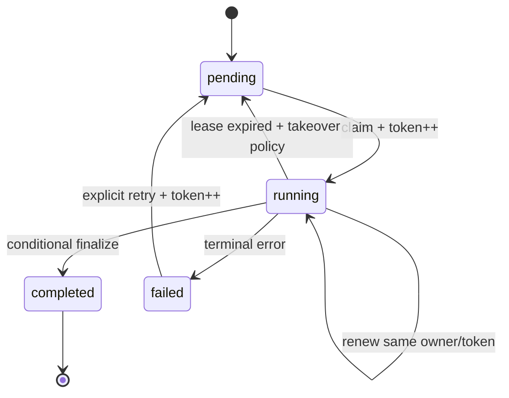

# Lease, fencing token và idempotency cho job dài

> [!abstract] Luận đề
> TTL chỉ cho phép hệ thống cấp lại quyền sau một thời gian; nó không dừng worker cũ. Một lease production cần claim/renew/release có điều kiện, token tăng đơn điệu, conditional finalize và side effect idempotent. Fencing chỉ có tác dụng nếu **tài nguyên được bảo vệ kiểm tra token**.

![[assets/lease-fencing-stale-owner-timeline.png]]

*Worker A không chết khi lease hết hạn: token 42 phải fence token 41 tại tài nguyên đích. Hình do AI tạo để minh họa.*

## 1. Failure khoa học: expiry không phải cancellation

Timeline kinh điển:

| Thời điểm | Worker A | Worker B | Lease store |
|---:|---|---|---|
| t0 | Claim token 41 | — | owner=A, token=41 |
| t1 | GC pause/network stall | — | TTL tiếp tục giảm |
| t2 | Vẫn pause | Claim token 42 | owner=B, token=42 |
| t3 | Tỉnh lại, tin mình còn quyền | Ghi thành công | A đã stale |

Không có TTL nào loại bỏ hoàn toàn kịch bản này: process pause, packet delay và clock uncertainty không có upper bound tuyệt đối trong hệ thống thực. Redis vì thế yêu cầu unique ownership value khi release và tài liệu hiện tại khuyến nghị fencing token cho correctness-sensitive work ([Redis — Distributed Locks](https://redis.io/docs/latest/develop/clients/patterns/distributed-locks/)).

## 2. DB lease schema tối thiểu

```sql
CREATE TABLE jobs (
    id              bigint PRIMARY KEY,
    status          text NOT NULL,
    payload         jsonb NOT NULL,
    lease_owner     text,
    lease_until     timestamptz,
    fencing_token   bigint NOT NULL DEFAULT 0,
    attempt         integer NOT NULL DEFAULT 0,
    idempotency_key text NOT NULL UNIQUE,
    result          jsonb,
    updated_at      timestamptz NOT NULL DEFAULT clock_timestamp(),
    CHECK ((lease_owner IS NULL) = (lease_until IS NULL))
);
```

`fencing_token` tăng sau mỗi lần cấp lease. `idempotency_key` chống tạo hai logical job giống nhau. `status` là state machine nghiệp vụ; lease chỉ là ownership tạm thời, không nên thay thế status.

## 3. Acquisition atomically

```sql
UPDATE jobs
SET lease_owner   = :worker_id,
    lease_until   = clock_timestamp() + :lease_duration,
    fencing_token = fencing_token + 1,
    attempt       = attempt + 1,
    status        = 'running',
    updated_at    = clock_timestamp()
WHERE id = :job_id
  AND status IN ('pending', 'running')
  AND (
      lease_until IS NULL
      OR lease_until < clock_timestamp()
  )
RETURNING id, lease_owner, lease_until, fencing_token, attempt, payload;
```

0 row nghĩa là claim thất bại. Không làm `SELECT expired` rồi `UPDATE` riêng, vì hai worker có thể cùng quan sát expired trước khi một bên ghi.

> [!note] Database time làm chuẩn
> Dùng `clock_timestamp()` trong PostgreSQL để so expiry, tránh để mỗi host tự gửi timestamp từ clock riêng. Điều này không biến lease thành proof of exclusivity; nó chỉ giảm một nguồn clock skew.

## 4. Renewal, release và finalize phải có điều kiện

### Renew

```sql
UPDATE jobs
SET lease_until = clock_timestamp() + :lease_duration,
    updated_at  = clock_timestamp()
WHERE id = :job_id
  AND lease_owner = :worker_id
  AND fencing_token = :token
  AND lease_until > clock_timestamp()
RETURNING lease_until;
```

0 row: worker đã mất quyền. Nó phải dừng phát sinh side effect mới. Đừng “renew hồi sinh” một lease đã hết hạn vì owner khác có thể đã takeover.

### Release khi hủy

```sql
UPDATE jobs
SET lease_owner = NULL,
    lease_until = NULL,
    status = 'pending',
    updated_at = clock_timestamp()
WHERE id = :job_id
  AND lease_owner = :worker_id
  AND fencing_token = :token;
```

### Finalize

```sql
UPDATE jobs
SET status = 'completed',
    result = :result,
    lease_owner = NULL,
    lease_until = NULL,
    updated_at = clock_timestamp()
WHERE id = :job_id
  AND status = 'running'
  AND lease_owner = :worker_id
  AND fencing_token = :token
  AND lease_until > clock_timestamp()
RETURNING id;
```

Conditional finalize ngăn A đánh dấu completed sau khi B đã takeover. Nhưng nếu A đã gửi tiền/email trước đó, row condition không thể rollback thế giới bên ngoài; đó là phần việc của idempotency.

## 5. Fencing token hoạt động ở đâu?

Token phải tăng đơn điệu và được tài nguyên đích kiểm tra:

```sql
UPDATE protected_resource
SET value = :value,
    last_fencing_token = :token
WHERE id = :id
  AND last_fencing_token < :token;
```

| Trường hợp | Kết quả |
|---|---|
| Token 42 đến trước | Resource lưu 42 |
| Token 41 đến sau | `WHERE 42 < 41` sai → reject |
| Retry token 42 | Cần CAS/idempotency tùy operation |

> [!warning] Token không được kiểm tra thì chỉ là metadata
> Một SaaS API không hỗ trợ fencing không thể tự nhiên hiểu token 42. Khi đó cần idempotency key do API hỗ trợ, outbox/inbox, unique constraint hoặc một gateway của ta đứng trước side effect.

## 6. Idempotency bảo vệ side effect trùng

Fencing trả lời “owner nào mới hơn?”. Idempotency trả lời “logical operation này đã thực hiện chưa?”. Hai cơ chế bổ sung nhau.

```sql
CREATE TABLE effect_ledger (
    idempotency_key text PRIMARY KEY,
    job_id          bigint NOT NULL,
    fencing_token   bigint NOT NULL,
    status          text NOT NULL,
    response        jsonb,
    created_at      timestamptz NOT NULL DEFAULT clock_timestamp()
);
```

Flow:

```text
1. INSERT effect_ledger(idempotency_key, ...) ON CONFLICT DO NOTHING
2. Chỉ owner insert thành công mới phát side effect
3. Lưu response/status để retry trả cùng kết quả
4. Finalize job có điều kiện theo fencing token
```

Với message broker at-least-once, inbox table có unique `(consumer, message_id)` là hàng rào tương tự. Với publish sau DB commit, dùng transactional outbox để không rơi vào “DB commit nhưng event chưa gửi”.

## 7. Redis lease đúng mức tối thiểu

Acquisition cơ bản trong tài liệu Redis:

```text
SET lock:resource-9823 <random-owner-token> NX PX 30000
```

`NX` chỉ set khi key chưa tồn tại, `PX` gắn expiry trong cùng command ([Redis — `SET`](https://redis.io/docs/latest/commands/set/)). Không dùng `SETNX` rồi `EXPIRE` riêng: client có thể chết giữa hai lệnh và để lock không TTL.

Release phải compare-and-delete atomically:

```lua
if redis.call("GET", KEYS[1]) == ARGV[1] then
  return redis.call("DEL", KEYS[1])
else
  return 0
end
```

Nếu chỉ `DEL`, owner A hết hạn có thể xóa key mới của B. Renewal cũng phải so sánh token trước khi gia hạn.

### Redis failover không tự tạo mutual exclusion mạnh

Nếu primary nhận lock nhưng chưa replicate thì crash, replica được promote có thể không chứa key; client B lấy cùng lock. Redis mô tả trực tiếp failure này khi giải thích vì sao asynchronous replication không đủ cho safety ([Redis — Distributed Locks](https://redis.io/docs/latest/develop/clients/patterns/distributed-locks/)).

Vì vậy:

- best-effort duplicate suppression: single-instance lease có thể đủ;
- correctness-critical mutation: resource phải fence token hoặc invariant nằm trong transactional store;
- đừng đồng nhất “Redis cluster có HA” với “mutual exclusion tuyến tính hóa”.

## 8. Chọn TTL và heartbeat bằng đo lường

Một starting heuristic:

```text
lease_duration > p99.9(pause + network + lease-store latency)
               + max_unrenewed_work_interval
               + safety_margin

renew_interval ≈ lease_duration / 3
```

Đây không phải proof. Nó chỉ làm giảm false expiry. TTL dài tăng thời gian takeover sau crash; TTL ngắn tăng xác suất worker sống bị mất lease.

| Đại lượng cần đo | Vì sao |
|---|---|
| Runtime/GC pause p99.9 | Worker có thể không renew dù còn sống |
| Lease-store latency p99.9 | Renewal có thể tới muộn |
| Network outage distribution | Mất kết nối ngắn gây false expiry |
| Time-to-stop sau renew fail | Giới hạn side effect sau mất quyền |
| Job step duration | Step dài phải fence/idempotent độc lập |
| Takeover latency | TTL dài ảnh hưởng recovery SLA |

## 9. Failure matrix

| Failure point | Trạng thái có thể xảy ra | Phòng vệ |
|---|---|---|
| Crash trước claim commit | Không owner | Retry bình thường |
| Crash sau claim | Lease còn đến expiry | Takeover sau TTL |
| Pause vượt TTL | Hai worker logic cùng chạy | Fencing tại resource |
| Renew request timeout | Không biết renew đã commit chưa | Đọc lại owner+token; dừng nếu không chứng minh được |
| Release bị retry sau takeover | Owner cũ xóa owner mới | Conditional release |
| Side effect thành công, response mất | Retry có thể gửi trùng | Idempotency key + effect ledger |
| DB finalize fail sau side effect | Job trông chưa xong | Retry same idempotency key, reconcile |
| Redis primary fail trước replication | Hai client có thể cùng tin mình giữ lock | Fence ở resource/stronger coordinator |
| Clock host lệch | Expiry sai nếu client tính thời gian | So sánh theo clock của lease store |
| Admin sửa owner thủ công | Protocol bị phá | Audited recovery command + token bump |

## 10. State machine đề xuất



State machine phải định nghĩa rõ ai được transition, điều kiện token nào, retry nào tạo attempt mới và terminal state nào không được claim lại.

## 11. Monitoring và bảng thống kê production

| Metric | Dimension | Mục đích |
|---|---|---|
| `lease_acquire_total` | success/conflict/error | Contention và availability |
| `lease_acquire_seconds` | resource type | Tail latency |
| `lease_renew_total` | success/lost/error | False expiry và store health |
| `lease_takeover_total` | previous owner | Crash/pause frequency |
| `stale_write_rejected_total` | resource | Bằng chứng fencing đang cứu hệ thống |
| `idempotency_replay_total` | effect type | Duplicate/retry pressure |
| `job_age_seconds` | state/type | Stuck jobs và SLA |
| `lease_remaining_seconds` | worker/type | Renew margin |
| `conditional_finalize_failed_total` | reason | Stale owner hoặc state drift |

Alert đáng giá nhất không phải “có conflict”, vì conflict là bình thường; hãy alert khi oldest-job age, renew failure, stale-write rejection hoặc takeover rate lệch baseline.

## 12. Mistakes chi tiết

| Mistake | Hậu quả | Sửa |
|---|---|---|
| TTL không có owner token | Không phân biệt người giải phóng | Random token/owner identity |
| `DEL` không compare | Owner cũ xóa lease mới | Atomic compare-and-delete |
| Renew lease đã hết hạn | Có thể hồi sinh owner stale | Renew chỉ khi owner+token khớp và chưa expiry |
| Token random dùng làm fencing order | Không biết owner nào mới hơn | Counter/sequence tăng đơn điệu |
| Có fencing token nhưng downstream bỏ qua | Stale write vẫn thành công | Check token ngay tại protected resource |
| Finalize chỉ theo `job_id` | Owner cũ hoàn tất job của owner mới | Match owner + token + state |
| Cho rằng “exactly once” từ lock | Crash có thể nằm giữa effect và checkpoint | Idempotency + ledger/outbox |
| Heartbeat mỗi sát expiry | Jitter nhỏ làm mất lease | Renew sớm, đo margin |
| TTL cực dài | Crash recovery chậm | TTL theo measurement + checkpoint nhỏ |
| Dùng Redis lock bảo vệ duy nhất tiền/tồn kho trong DB | Dual-state race | DB constraint/transaction là backstop |

## 13. Checklist kiểm thử failure injection

- [ ] Kill process ngay sau claim commit.
- [ ] Pause process lâu hơn TTL rồi resume.
- [ ] Drop renewal response sau khi server đã xử lý.
- [ ] Cho A token 41 ghi sau B token 42.
- [ ] Retry release của A sau khi B takeover.
- [ ] Side effect thành công nhưng giả lập mất response.
- [ ] Fail DB finalize sau side effect.
- [ ] Promote Redis replica trước khi lock replicate.
- [ ] Chạy hai worker cùng claim một resource 10.000 lần và đối soát.
- [ ] Kiểm tra dashboard ghi nhận stale rejection và idempotency replay.

## 14. Kết luận

Một long-running job đáng tin cậy không dựa vào một mutex kéo dài 40 phút. Nó dựa vào các bước nhỏ có thể phục hồi: claim atomically, lease có expiry, token tăng đơn điệu, renew/release/finalize có điều kiện, tài nguyên đích từ chối token cũ và side effect có idempotency key. Lease tạo liveness; fencing và idempotency mới bảo vệ correctness.

## Nguồn chính

- [Redis — Distributed Locks](https://redis.io/docs/latest/develop/clients/patterns/distributed-locks/)
- [Redis — `SET` command, `NX` và `PX`](https://redis.io/docs/latest/commands/set/)
- [PostgreSQL — `UPDATE ... RETURNING`](https://www.postgresql.org/docs/current/sql-update.html)
- [PostgreSQL — Transaction Isolation](https://www.postgresql.org/docs/current/transaction-iso.html)
- [PostgreSQL — Explicit Locking](https://www.postgresql.org/docs/current/explicit-locking.html)
- [MySQL 8.4 — Named Lock Semantics](https://dev.mysql.com/doc/refman/8.4/en/locking-functions.html)

