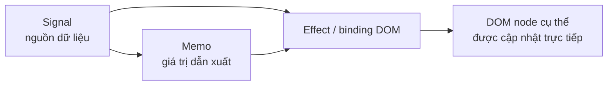
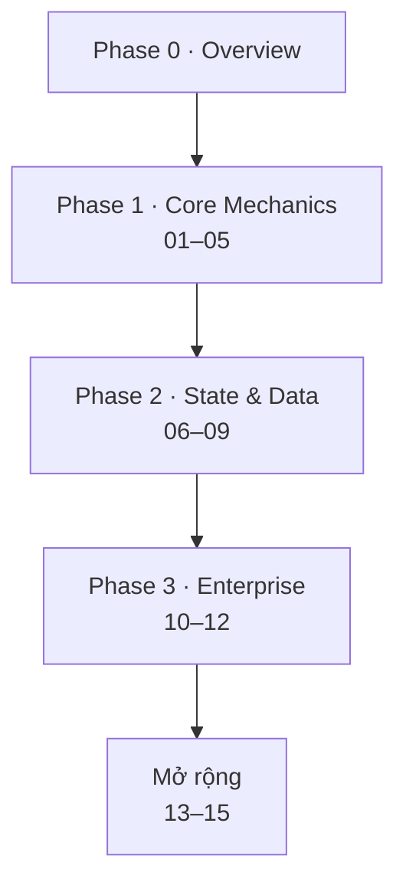

# SolidJS 00 — Overview & Setup: Bản đồ khóa học

#solidjs #frontend #overview #phase-0

> **Mục tiêu:** Cho người học nhìn thấy toàn cảnh trước khi vào bài 01: SolidJS là gì, khóa học này dạy phiên bản nào, đi theo thứ tự nào, và những API nào sắp thay đổi khi Solid 2.0 ra bản ổn định.

---

## 📌 SolidJS là gì

SolidJS là thư viện UI dùng cú pháp JSX giống React nhưng **không có Virtual DOM**. Nó dựa trên **fine-grained reactivity**: component chỉ chạy một lần để dựng DOM và nối các liên kết reactive; khi dữ liệu đổi, chỉ đúng biểu thức đọc dữ liệu đó chạy lại.

Hai ý cần nhớ trước khi học (chi tiết ở [[SolidJS-Series/SolidJS-01-Reactivity-Internals]] và [[SolidJS-Series/SolidJS-04-JSX-Component-Model]]):

- Đọc signal bên trong một *tracking scope* (effect, memo, JSX) thì mới được theo dõi.
- Không destructure `props` hoặc store, vì sẽ mất reactivity.

---

## 🧭 Phiên bản và hiện trạng (kiểm tra ngày 2026-10-25)

| Dòng | Trạng thái | Ghi chú |
|---|---|---|
| **1.x** | Dòng ổn định | Khóa học này viết theo API của 1.x. Type definitions của `solid-js@1.9.12` xuất hiện trên unpkg |
| **2.0** | **Release Candidate** | `v2.0.0-beta.0` ngày 2026-03-03; bản mới nhất trên trang GitHub Releases khi kiểm tra là `solid-js@2.0.0-rc.9` (2026-09-18), đánh dấu *Pre-release*. Tài liệu xem trước ở `v2.solidjs.com` |

> [!warning] Khóa học dạy Solid 1.x
> Solid 2.0 đổi mô hình async và một số API cốt lõi. Khi 2.0 ra bản ổn định, các bài dùng những API ở bảng dưới cần được cập nhật. Trong lúc đó, nội dung 1.x vẫn đúng cho dự án chạy trên 1.x.

### API trong series bị ảnh hưởng bởi Solid 2.0

| API 1.x (dùng trong series) | Thay đổi ở 2.0 theo nguồn | Bài liên quan (đã đối chiếu) |
|---|---|---|
| `createResource` | Bị gỡ; async chạy qua memo thông thường (computation có thể trả Promise) | [[SolidJS-Series/SolidJS-08-Async-Resources]] |
| `<Suspense>` | Beta nêu `<Loading>` cho lần render đầu và `isPending` cho revalidation | [[SolidJS-Series/SolidJS-08-Async-Resources]] |
| `batch` | Bị gỡ | [[SolidJS-Series/SolidJS-06-Stores-Nested-State]] (import `batch` trong ví dụ), [[SolidJS-Series/SolidJS-02-Signals-Deep-Dive]] (theo bảng tra nhanh ở MOC) |
| `onMount` | Thay thế gần nhất là `onSettled` (không phải đổi tên 1:1) | [[SolidJS-Series/SolidJS-03-Effects-And-Lifecycle]] (theo bảng tra nhanh ở MOC) |
| `<Dynamic>` | Đánh dấu `@deprecated` ở rc.9, vẫn còn trong 2.0; khuyến nghị dùng `dynamic()` | [[SolidJS-Series/SolidJS-04-JSX-Component-Model]] (Pattern polymorphic component) |
| `ErrorBoundary` | rc.9 dùng tên `<Errored>` / `createErrorBoundary` cho error boundary; cần đối chiếu migration guide xem tên cũ còn không | [[SolidJS-Series/SolidJS-08-Async-Resources]] |

> [!note] Phạm vi đã kiểm tra
> Bảng trên chỉ phản ánh các bài đã đọc trực tiếp (01, 04, 06, 08) và bảng tra nhanh ở [[SolidJS-Series/SolidJS-MOC]]. Chưa quét hết 12 bài. Việc rà soát đầy đủ nằm ở giai đoạn P3 của kế hoạch audit.

Một số thay đổi khác của RC không ảnh hưởng trực tiếp tới nội dung bài học nhưng đáng biết: trình biên dịch mới viết bằng Rust trên OXC (`@solidjs/vite-plugin` dùng mặc định), `"use server"` trở thành tính năng lõi, và key của delegated event đổi từ `$$click` sang `_$$click` (chỉ ảnh hưởng code đọc trực tiếp key này).

---

## 🗺️ Bản đồ khóa học

| Phase | Bài | Nội dung cốt lõi |
|---|---|---|
| 0 | 00 (bài này) | Toàn cảnh, phiên bản, setup |
| 1 | [[SolidJS-Series/SolidJS-01-Reactivity-Internals]] | Reactive graph, tracking context, ownership |
| 1 | [[SolidJS-Series/SolidJS-02-Signals-Deep-Dive]] | createSignal, createMemo, batch, untrack |
| 1 | [[SolidJS-Series/SolidJS-03-Effects-And-Lifecycle]] | createEffect, onMount, onCleanup |
| 1 | [[SolidJS-Series/SolidJS-04-JSX-Component-Model]] | Compile model, run-once, mergeProps, splitProps |
| 1 | [[SolidJS-Series/SolidJS-05-Control-Flow-Primitives]] | Show, For, Index, Switch, Dynamic |
| 2 | [[SolidJS-Series/SolidJS-06-Stores-Nested-State]] | createStore, produce, reconcile |
| 2 | [[SolidJS-Series/SolidJS-07-Context-DI]] | Context, Provider, service layer |
| 2 | [[SolidJS-Series/SolidJS-08-Async-Resources]] | createResource, Suspense, ErrorBoundary |
| 2 | [[SolidJS-Series/SolidJS-09-Routing]] | @solidjs/router, nested routes, loaders |
| 3 | [[SolidJS-Series/SolidJS-10-Complex-UI-Patterns]] | Forms, data table, virtual scroll |
| 3 | [[SolidJS-Series/SolidJS-11-SolidStart-SSR]] | Server functions, streaming SSR |
| 3 | [[SolidJS-Series/SolidJS-12-Performance-Testing]] | Profiling, Vitest, Feature-Slice |
| Mở rộng | [[SolidJS-Series/SolidJS-13-Routing-Layout-SearchState]] | Routing, layout, search state |
| Mở rộng | [[SolidJS-Series/SolidJS-14-Multiple-Outlets-Pattern]] | Bài ngắn (~1.5 KB), chưa phát triển đầy đủ |
| Mở rộng | [[SolidJS-Series/SolidJS-15-Reactivity-vs-React-vDOM]] | Bài ngắn (~1.5 KB), chưa phát triển đầy đủ |

Lộ trình đề xuất, các đường học theo mục tiêu (A–D) và bảng tra nhanh API nằm ở [[SolidJS-Series/SolidJS-MOC]].

> [!info] Về series cũ `00-Roadmap` … `06-Enterprise-Architecture`
> Đây là bản nháp đầu, đã được series `SolidJS-xx` thay thế về chủ đề. Chúng được giữ nguyên trong vault chờ hoàn tất đối chiếu nội dung, và không dùng làm tài liệu chính.

---

## 🧰 Tiền đề

- JavaScript/TypeScript hiện đại: arrow function, closure, module, Promise và `async/await`.
- JSX cơ bản và sự kiện DOM.
- Biết React giúp so sánh, nhưng không bắt buộc. Các bài thường đối chiếu với React để làm rõ khác biệt.

## 🛠️ Setup

- **Solid 1.x:** làm theo hướng dẫn chính thức tại `docs.solidjs.com` (mục Quick start). Lệnh khởi tạo project thay đổi theo thời gian nên bài này không chép lại.
- **Thử Solid 2.0:** ở giai đoạn beta, cài bằng `npm install solid-js@next @solidjs/web@next` (theo InfoQ). Với RC, hãy kiểm tra lại thẻ phiên bản trên npm và đọc migration guide ở `v2.solidjs.com` trước khi dùng.
- **Vite plugin của 2.0:** `@solidjs/vite-plugin`.

---

## 📚 Quy ước đọc series

- Thứ tự mỗi bài: bản chất → cơ chế → API → thực chiến → pitfall (mechanism-first).
- Ví dụ theo ngữ cảnh banking (khoản vay, hồ sơ tín dụng) để gần với bài toán doanh nghiệp.
- Ký hiệu ❌ là cách sai, ✅ là cách đúng; hashtag cuối tiêu đề đánh dấu phase.

---

## 🔗 Liên kết

→ [[SolidJS-Series/SolidJS-01-Reactivity-Internals|01 · Reactivity Internals]]

**Xem thêm:**
- [[SolidJS-Series/SolidJS-MOC|SolidJS Master Index]] — lộ trình, đường học, bảng tra nhanh
- [[concepts/frontend-concept-map|Frontend Concept Map — SolidJS ↔ React ↔ Angular]]

## 📖 Nguồn

- [solidjs/solid — Releases](https://github.com/solidjs/solid/releases) (trạng thái RC, ghi chú rc.9 ngày 2026-09-18)
- [Solid 2.0 RC — thông báo](https://github.com/solidjs/solid/discussions/2995)
- [SolidJS 2.0 Beta — InfoQ](https://www.infoq.com/news/2026/05/solidjs-2-async/)
- [createResource — tài liệu 1.x](https://docs.solidjs.com/reference/basic-reactivity/create-resource)
- [Solid 2.0 preview docs](https://v2.solidjs.com)

---

*Series: [[SolidJS-Series/SolidJS-MOC|SolidJS Master Index]]*
